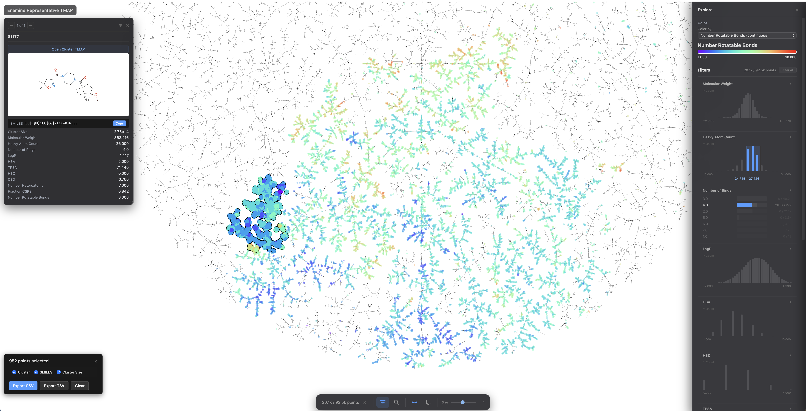
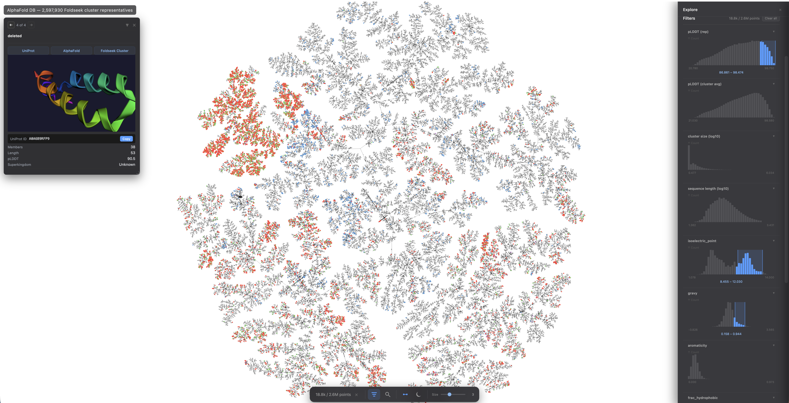

[](https://github.com/afloresep/tmap2/actions/workflows/tests.yml)
[](https://pypi.org/project/tmap2/)
[](https://www.python.org/downloads/)
[](#installation)

# TMAP2

TMAP2 draws high-dimensional data as a tree in 2D. Similar items land on the same branch, and the branches show how groups connect to each other. It works for chemical space, protein embeddings, single-cell data, and any other dataset you can turn into fingerprints or vectors.

<table>
  <tr>
    <td></td>
    <td></td>
  </tr>
</table>

## Why Trees?

Most dimensionality reduction tools (UMAP, t-SNE, PCA) produce point clouds. TMAP produces a **tree**, a connected structure where every point is linked to its neighbors through branches. This makes the layout itself explorable because you can follow branches, trace paths between any two points, and discover how regions connect.

For example, in a TMAP of pet breed images, the branch from terriers to cats runs through chihuahuas and then sphynx cats (the bald ones). It's hilarious and also logical: both are small, short-haired, and have big eyes. So besides grouping similar things, the tree shows *how* groups that look unrelated are connected.

<p align="center">
  
</p>

Because the layout is a tree, you get operations that point clouds can't support:

```python
path = model.path(idx_a, idx_b)        # nodes along the tree path
d = model.distance(idx_a, idx_b)        # sum of edge weights along the path
n = model.hops(idx_a, idx_b)            # number of tree edges between two points
pseudotime = model.distances_from(idx)  # tree distance from one point to all others
steps = model.hops_from(idx)            # tree edges from one point to all others
```

The same path tracing and tree-distance coloring are available inside the interactive HTML: pin two points and the inspector lists the path, or color the whole map by tree distance from a selected point. For analysis on the tree itself, `tmap.graph` has helpers such as `boundary_edges`, `subtree_purity`, and `path_properties`.

## Installation

```bash
pip install tmap2
```

Wheels are published for Linux x86_64, macOS arm64 (Apple Silicon), and Windows x86_64 on Python 3.11 to 3.13. Other platforms build the OGDF layout extension from source and need CMake and a C++17 compiler.

The chemistry helpers (`fingerprints_from_smiles`, `molecular_properties`, `murcko_scaffolds`, `reaction_properties`) run on several worker processes. Python starts those workers by re-importing your script, so scripts that call the helpers need the usual `if __name__ == "__main__":` guard on every platform. Notebooks don't need it.

Optional extras:

```bash
pip install "tmap2[chemistry]"   # RDKit: fingerprints, molecular properties, scaffolds
pip install "tmap2[notebook]"    # jupyter-scatter: viz.show() and model.plot() in Jupyter
pip install "tmap2[proteins]"    # Biopython: ProtParam properties, PDB parsing
pip install "tmap2[singlecell]"  # anndata: from_anndata and the other single-cell helpers
pip install "tmap2[all]"         # everything above
```

> **Note:** You install `tmap2` and import `tmap`.

## Quick Start 

### Binary Data (e.g. Chemical Fingerprints)

```python
from tmap.utils import fingerprints_from_smiles
from tmap import TMAP

smiles = [...]  # your SMILES list
# Binary fingerprints (Jaccard distance). `valid` flags the SMILES RDKit could parse,
# so you can drop the same rows from any labels or properties you attach later.
fps, valid = fingerprints_from_smiles(smiles, fp_type="morgan", radius=2, n_bits=2048, return_valid=True)
model = TMAP(metric="jaccard", n_neighbors=20).fit(fps)
viz = model.to_tmapviz()
viz.write_html("map.html")  # interactive HTML, open in a browser
# viz.show()                # or render inline in a Jupyter notebook
```

### Continuous Vectors (e.g. Protein Embeddings)

```python
import numpy as np
from tmap import TMAP

# embeddings (use cosine / euclidean distances)
X = np.random.random((1000, 128)).astype(np.float32)
model = TMAP(metric="cosine", n_neighbors=20).fit(X)
viz = model.to_tmapviz()
viz.show()                    # inline in a Jupyter notebook
# viz.write_html("tmap.html") # or save as interactive HTML
```

`viz.show()` needs the `notebook` extra. The notebook widget draws the points and skips the tree edges (it warns about this); the HTML export draws both.

## Key Features

- **Tree structure**: follow branches, trace paths, count hops, compute pseudotime
- **Always one tree**: a too-low `n_neighbors` can fragment the kNN graph; TMAP bridges the pieces so `path` and `distance` stay defined (`connect_components=True`, inspect with `n_components_`)
- **Reproducible on request**: the layout is always seeded. The HNSW index used for binary Jaccard (and for cosine/euclidean from 50,000 points up) is built on several threads, so two runs can differ slightly. `reproducible=True` builds it on one thread and gives identical coordinates every time (slower)
- **Multiple metrics**: `jaccard`, `cosine`, `euclidean`, `precomputed`, or bring your own kNN graph with `fit(knn_graph=...)`
- **Incremental**: `add_points()` adds new points to a fitted map and `transform()` places them without changing it. For cosine/euclidean, fit with `store_index=True` first
- **Model persistence**: `save()` / `load()`
- **Three viz backends**: interactive HTML, jupyter-scatter, matplotlib

## Visualization (add colors, labels...) 

### Add Colors & Labels

To add a color layer, pass a name (e.g. "Molecular Weight" or "Protein Length"), one value per point, and optionally a matplotlib colormap. Continuous values use a colormap like `viridis` (the default). For categories such as scaffolds or cell types, pass `categorical=True`; these use a qualitative palette like `tab10` (the default) or your own list of hex colors.
Labels are values you want to see in tooltips and cards without coloring by them. Pass a name and one value per point.

```python
model = TMAP(metric="jaccard").fit(X)
viz = model.to_tmapviz() 
viz.add_color_layout("Molecular Weight", mw.tolist(), categorical=False) 
viz.add_color_layout("Scaffold", scaffolds, categorical=True, color="tab10")
viz.add_label("SMILES", smiles_list)
viz.show(width=1000, height=620, controls=True) # to see in jupyter notebook
# viz.write_html("mytmap.html") # to save and see as HTML in the browser
```
> Here SMILES are added as a plain label, so no 2D structure is drawn. To render structures in tooltips and cards, use `viz.add_smiles(smiles_list)` instead. For image datasets use `viz.add_images(data_uris)`, with one `"data:image/png;base64,..."` string per point.

### Filters, cards and structures

```python
viz.add_filter("Ring Count", n_rings, categorical=True)   # filter-panel column without a color map
viz.configure_column("UniProt ID", link_template="https://www.uniprot.org/uniprotkb/{UniProt ID}")
viz.configure_card(title_column="Name", fields=["Molecular Weight", "Scaffold"])
viz.add_3d_structures(alphafold_urls, source="url", fmt="pdb")   # or add_3d_structure_files(local_paths)
```

`add_filter` puts a column in the filter panel without computing colors for it, which is cheaper than `add_color_layout` when you only want to filter. Color layouts appear in the filter panel by default; set `viz.filterable = [...]` to choose the exact list. `configure_column` and `configure_card` control links, formatting and what the pinned card shows. In `link_template`, `{column name}` is replaced with that column's value for the point. `add_3d_structures` and `add_3d_structure_files` attach PDB or mmCIF structures that render in the card.

### Interactive HTML

`viz.write_html("name.html")` writes one HTML file with the data embedded. It opens in a browser without a server, but it loads a few JavaScript libraries from a CDN, so the viewer needs internet access. The page has lasso selection, light and dark themes, filter and search panels, and pinned metadata cards. For maps too big for a single file, `viz.write_static("my_map/")` writes the page and its data as separate files for any static web host, and `viz.serve()` does the same in a temporary folder, opens it in your browser, and keeps serving until you press Ctrl+C.

Selecting a point opens the **inspector**:

- **Neighbors**: the point's tree neighbors with similarity scores, property differences and structures or images. Hovering a neighbor highlights the connecting edge.
- **Path**: pin a second point to trace the tree path between them, listing each node with its step number and running tree distance.
- **Color by tree distance**: color the whole map by tree distance from the selected point, using the normal color menu.

For publication figures use matplotlib: `model.plot_static(color_by=labels)`.

## Domain Utilities

Built-in helpers for common scientific workflows:

```python
from tmap.utils.chemistry import fingerprints_from_smiles, molecular_properties
from tmap.utils.proteins import fetch_uniprot, sequence_properties
from tmap.utils.singlecell import from_anndata
```

| Domain | Metric | Utilities |
|--------|--------|-----------|
| Chemoinformatics | `jaccard` for binary fingerprints (Morgan, MAP4, MHFP, DRFP); `cosine` / `euclidean` for count fingerprints (MQN, MXFP) | `fingerprints_from_smiles` (`return_valid=True` flags unparseable SMILES), `molecular_properties`, `murcko_scaffolds`, `reaction_properties` |
| Proteins | `cosine` / `euclidean` | `fetch_uniprot`, `fetch_alphafold`, `read_fasta`, `read_id_list`, `read_pdb`, `read_pdb_dir`, `read_protein_csv`, `sequence_properties`, `parse_alignment` |
| Single-cell | `cosine` / `euclidean` | `from_anndata`, `cell_metadata`, `marker_scores`, `obs_to_numeric`, `subset_anndata`, `sample_obs_indices` |
| Generic embeddings | `cosine` / `euclidean` / `precomputed` | No domain utils needed |

## Examples

Runnable scripts for chemistry, images, proteins and text live in [`examples/`](examples/README.md). The quickest to try uses the bundled CSV and downloads nothing:

```bash
python examples/chemistry/molecules_tmap.py --nrows 3000
```

## Documentation

The guides in [`docs/`](docs/index.md) cover each part of the pipeline in more depth: the [molecule tutorial](docs/molecule_tutorial.md), [visualization](docs/visualization_guide.md), the [API reference](docs/api_reference.md), and the lower-level [MinHash](docs/minhash_guide.md), [LSHForest](docs/lshforest_guide.md), [USearch](docs/usearch_backend.md), [graph](docs/graph_guide.md), and [layout](docs/layout_guide.md) guides.

## Notebooks

| Notebook | Topic |
|----------|-------|
| [01 Quickstart](notebooks/01_quickstart.ipynb) | Shortest end-to-end walkthrough on a small molecule table |
| [02 Cheminformatics](notebooks/02_cheminformatics.ipynb) | SMILES → fingerprints → interactive molecular map |
| [03 Continuous Embeddings](notebooks/03_continuous_embeddings.ipynb) | Cosine and euclidean on MNIST: when to use each |
| [04 Working with a Fitted Model](notebooks/04_working_with_a_fitted_model.ipynb) | `kneighbors`, `transform`, `add_points`, tree paths and hops, disconnected graphs, save/load, external kNN |
| [05 Single-Cell](notebooks/05_single_cell.ipynb) | RNA-seq with PBMC 3k, pseudotime, UMAP comparison |
| [06 FAQ](notebooks/06_faq.ipynb) | Troubleshooting and common questions |
| [07 MinHash Deep Dive](notebooks/07_minhash_deep_dive.ipynb) | Encoding methods and when to use each |
| [08 Notebook Widgets](notebooks/08_jscatter_demo.ipynb) | Coloring, tooltips, lasso selection with jupyter-scatter |
| [09 Card Configuration](notebooks/09_card_configuration.ipynb) | Pinned card layout, fields, and links |
| [10 Protein Analysis](notebooks/10_protein_analysis.ipynb) | FASTA, ESM embeddings, AlphaFold |
| [11 USearch Jaccard](notebooks/11_usearch_jaccard.ipynb) | Native binary Jaccard backend (high recall, low memory) |
| [12 Lower-Level Pipeline](notebooks/12_lower_level_pipeline.ipynb) | MinHash + LSHForest + OGDF layout + `TmapViz`, step by step |
| [13 Local Protein Structures](notebooks/13_local_protein_structures.ipynb) | Pinned cards with locally stored PDB/mmCIF structures |
| [14 CAZyme Analysis](notebooks/14_cazyme_analysis.ipynb) | GH43 glycoside hydrolase family map, contributed example |

## Lower-Level Pipeline

For direct control over indexing, hashing, and layout, see the [lower-level pipeline notebook](notebooks/12_lower_level_pipeline.ipynb). The main building blocks:

```python
from tmap.index import USearchIndex, KNNGraph # dense / binary kNN, or your own neighbors
from tmap import MinHash, LSHForest           # Jaccard on sets / strings
from tmap.layout import LayoutConfig, layout_from_lsh_forest
```

`TMAP.fit` picks the neighbor search from the input:

```text
Your Data
   ├─→ Dense binary matrix (0/1) ────→ USearch, Jaccard
   ├─→ Dense float matrix ───────────→ USearch, cosine / euclidean
   ├─→ Sets, strings, sparse matrix ─→ MinHash → LSHForest
   └─→ Distance matrix or KNNGraph ──→ precomputed neighbors
                ↓
             k-NN Graph → bridge components → MST → OGDF Tree Layout → Interactive Visualization
```

USearch runs an exact search for cosine and euclidean below 50,000 points and switches to HNSW above that. Binary Jaccard always uses HNSW.

## Development

```bash
git clone https://github.com/afloresep/tmap2.git
cd tmap2
pip install ".[dev]"
pytest -v
```

## License

MIT License; see [LICENSE](LICENSE) for details.

## Citation

If you use TMAP2 in your research, please cite:

> **From Proteins and Molecules to Cats and Dogs: Visualization as Scalable Minimum Spanning Trees**  
> Alejandro Flores Sepúlveda, Maarten Boneschansker, Daniel Probst, Jean-Louis Reymond  
> *ChemRxiv*, 2026.  
> [https://doi.org/10.26434/chemrxiv.15008307/v1](https://doi.org/10.26434/chemrxiv.15008307/v1)

```bibtex
@article{floressepulveda2026tmap,
  title   = {From Proteins and Molecules to Cats and Dogs: Visualization as Scalable Minimum Spanning Trees},
  author  = {Flores Sepúlveda, Alejandro and Boneschansker, Maarten and Probst, Daniel and Reymond, Jean-Louis},
  year    = {2026},
  doi     = {10.26434/chemrxiv.15008307/v1},
  url     = {https://doi.org/10.26434/chemrxiv.15008307/v1},
  note    = {ChemRxiv preprint}
}
```
